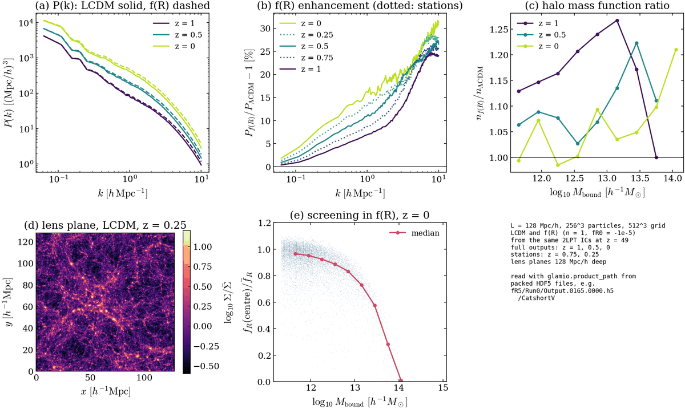

# Example: an LCDM / f(R) twin at L = 128 Mpc/h

A small, complete MG-GLAM campaign that shows the current way of setting up,
running, checking and post-processing simulations. Two boxes of 128 Mpc/h with
256^3 particles and a 512^3 force grid (the resolution of the 1 Gpc/h
production runs: 0.5 Mpc/h particle spacing, 0.25 Mpc/h cells) start from the
same 2LPT initial conditions; one evolves with general relativity (LCDM), the
other with Hu-Sawicki f(R) gravity (n = 1, fR0 = -1e-5). The whole example
takes about half an hour, part of it queueing, and about 7 core-hours.

## What it shows

| feature | where |
|---|---|
| 2LPT initial conditions at z = 49 with the FML generator | `1_ics.sh`, `input.lua.in` |
| ICs ingested by `ic2pm` with velocities at the leapfrog half step, products tagged with the realisation number | `run_job.sh` |
| output redshifts hit exactly, in two classes: full outputs (z = 1, 0.5, 0) and stations (z = 0.75, 0.25) | `config.sh`, `2_inputs.sh` (`gen_inputs.py --redshifts ... --stations ...`) |
| products: P(k) at every output, lens planes, BDM halo catalogues (binary), low-k density and momentum mode cubes, a 1-in-100 particle subsample, f_R at the halo centres (f(R) only) | `2_inputs.sh`, written by the runs into `Run0/` |
| a frozen copy of the executables per run (`bin/` with md5 sums), no checkpoints, no particle snapshots | `2_inputs.sh`, `run_job.sh` |
| the twin pair: identical ICs and inputs except for gravity (`PMP2main` / `PMP2MG`) | `2_inputs.sh` |
| verification of a finished run | `4_check.sh` (`DEGRACE-companion/check_run.py`) |
| post-processing: one HDF5 file per output, a byte-for-byte check, the original files deleted | `5_postprocess.sh` (`DEGRACE-companion/pack_run.sh`) |
| reading the packed outputs with `glamio`, unchanged code for native and packed runs | `analyse.py` |

## Before you start

The scripts are written for COSMA8 (Slurm, the Intel oneAPI 2024.2 modules).

1. Build GLAM in the repository root (`PMP2init.exe`, `ic2pm.exe`,
   `PMP2main.exe`, `PMP2MG.exe`):
   ```sh
   module purge; module load intel_comp/2024.2.0; export I_MPI_F90=ifx
   module load compiler-rt tbb compiler mpi
   make PMP2init PMP2main PMP2MG ic2pm
   ```
2. Build the FML 2LPT generator as described in
   [`2LPTIC_Gui/README.md`](../../2LPTIC_Gui/README.md) (executable
   `2LPTIC_Gui/FML/FML/LPT/example/test`, or set `FML_DIR`). Its Makefile
   (`2LPTIC_Gui/fml_intel_port/Makefile.intel`) points `FML_INCLUDE` and the
   Lua library at the authors' installations: set them to yours.
3. A Python environment with numpy, scipy, h5py and matplotlib; `glamio` is
   taken from this repository. `PYTHON` names it (default `python3`), e.g.
   `export PYTHON="micromamba run -n <env> python3"`.
4. Choose a new work directory on the data file system and give your Slurm
   account (both required):
   ```sh
   export WORK=/cosma8/data/<project>/$USER/mgglam-example
   export ACCOUNT=<project>
   ```

## Running it

```sh
cd examples/twin_L128Np256Ng512
./run_all.sh                 # all steps and the figure
```

Every step skips work that is already done and waits for its jobs still
queued or running, so after a failure or a Ctrl-C (the submitted jobs keep
running) you simply run the script again. A simulation that ended without
finishing (`Run0/job_done.txt` missing) is not resubmitted on top of its
remains: remove that twin's directory and rerun from `2_inputs.sh`.

or step by step:

| step | what it does | writes | time |
|---|---|---|---|
| `1_ics.sh` | linear P(k) at z = 49 from the shipped CAMB z = 0 spectrum, FML 2LPT ICs (8 MPI tasks), md5 sums, IC power check | `$WORK/ICs/` | < 1 min |
| `2_inputs.sh` | `Init.dat`, `PkTable.dat`, `Run0/BDM.config`, provenance and `bin/` for both twins | `$WORK/LCDM/`, `$WORK/fR5/` | seconds |
| `3_run.sh` | both simulations at once, 16 threads each | `$WORK/<twin>/Run0/` | 10-20 min |
| `4_check.sh` | `check_run.py` on both runs | (screen) | seconds |
| `5_postprocess.sh` | `pack_run.sh` on both runs: pack, byte check, delete the originals (`KEEP_ORIGINALS=1` keeps them) | `Run0/Output.*.h5`, `RunInfo.0000.h5`, `packed.md5` | ~1 min |
| `analyse.py` | the figure from the packed files | `$WORK/figures/showcase.{png,pdf}` | seconds |

After the run, `$WORK` holds:

```
ICs/                 IC_L128Np256_seed2026.0-7 (Gadget), md5sum.txt, _deltaL modes, P(k) files, input.lua, job log
LCDM/  fR5/          Init.dat, PkTable.dat, inputs_provenance.json, Setup.dat, bin/, Slurm logs, and
  Run0/                Output.<step>.0000.h5 (one per output), RunInfo.0000.h5 (schedule, logs), packed.md5
figures/             showcase.png, showcase.pdf
```

`$PYTHON -m glamio.pack unpack $WORK/LCDM/Run0 --out <dir>` rebuilds the
native files byte for byte if a tool needs them.

## Expected results

From the reference run on COSMA8 (2026-10-24, `cosma8-serial`); GLAM's
parallel density assignment is not bitwise reproducible, so your numbers should
agree to a few tenths of a per cent rather than exactly.

- `1_ics.sh`: IC power / input spectrum 1.004 on average over 0.1 < k < 1 h/Mpc.
- `3_run.sh`: 165 steps each, 16 threads; LCDM 8-10 min with a peak memory
  of 1.7 GB, f(R) 16-17 min (about 7 of them in the f(R) multigrid solver) and
  2.3 GB (`main.time`; Slurm's MaxRSS for the whole jobs: 2.3-2.6 and 3.0 GB).
- `4_check.sh`: `0 FAIL, 0 WARN` for both runs; the 1-D velocity rms of the ICs
  is 46.7 km/s (the script's "expect ~50" refers to 1 Gpc/h boxes; a 128 Mpc/h
  box lacks the longest modes).
- `5_postprocess.sh`: 68 (LCDM) and 74 (f(R)) files, every one byte-identical
  to its rebuilt copy, replaced by 7 files per run.
- `analyse.py` (figure below, `$WORK/figures/showcase.png`):

  | z | P_fR/P_LCDM - 1 at k = 0.5 / 1 / 3 h/Mpc | haloes above 10^11.5 Msun/h, LCDM / f(R) |
  |---|---|---|
  | 1 | +4.9 / +6.9 / +12.6 % | 10446 / 12076 |
  | 0.75 (station) | +6.3 / +8.6 / +16.2 % | |
  | 0.5 | +8.3 / +10.9 / +18.8 % | 10400 / 11166 |
  | 0.25 (station) | +10.6 / +13.2 / +17.7 % | |
  | 0 | +12.8 / +16.3 / +20.3 % | 8540 / 8757 |

  The enhancement grows with time and with k, as for |fR0| = 1e-5 in 1 Gpc/h
  boxes. Haloes are increasingly screened above ~10^13 Msun/h: the median f_R
  at their centre falls from 0.95 of the background value at 10^12 to 0.3 at
  10^13.8 (panel e).



## Changing it

Edit `config.sh` and use a new `WORK` (the steps skip what exists, so edits
do not reach an existing run): the output redshifts (`FULL_Z`, `STATION_Z`,
which may be empty), the box (`BOX`, `NP`, `NG`; keep `NP` divisible by 8 for
the IC job and `NG` by 2), the seed, `FR0`. `gen_inputs.py --help` lists the
other run options (lens-plane
slabs, mode-cube cut-offs, subsample factor, catalogue format). The rules
the production runs follow are in [`AGENTS.md`](../../AGENTS.md) ("After a
simulation finishes"), the packed format in
[`python/README.md`](../../python/README.md) ("Packed runs"), and the run
workflow in [`DEGRACE-companion/README.md`](../../DEGRACE-companion/README.md).

## Cleaning up

`rm $WORK/ICs/IC_L128Np256_seed2026.[0-7]` frees 0.5 GB and keeps the
recipe: `1_ics.sh` regenerates the Gadget files and checks them against the
recorded `md5sum.txt`. `rm -r $WORK` removes everything.
